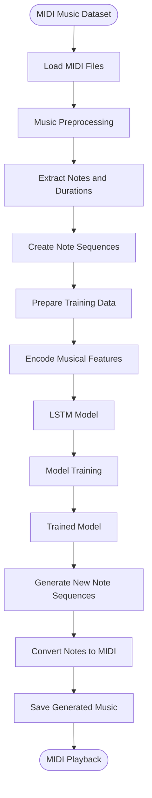
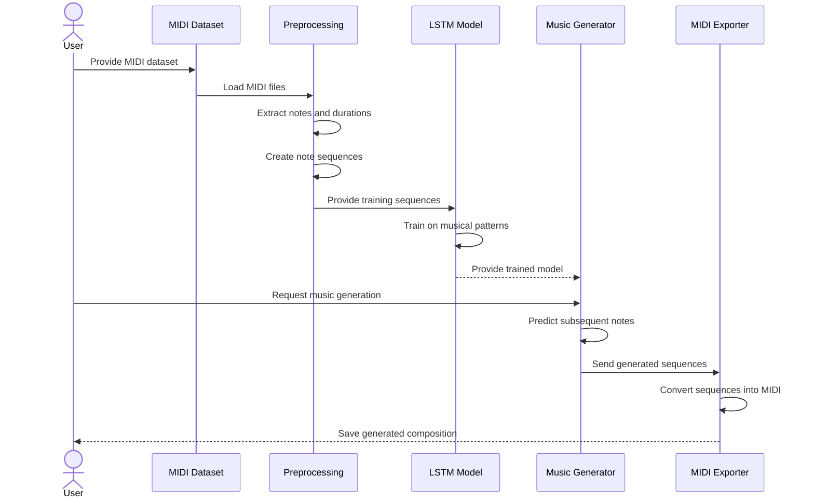
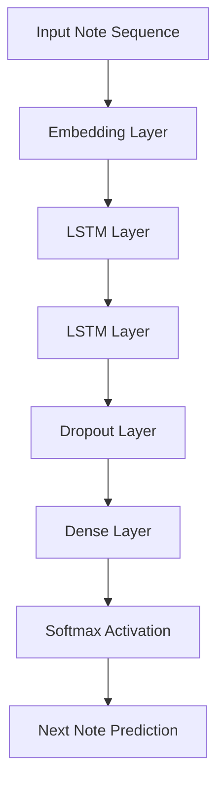
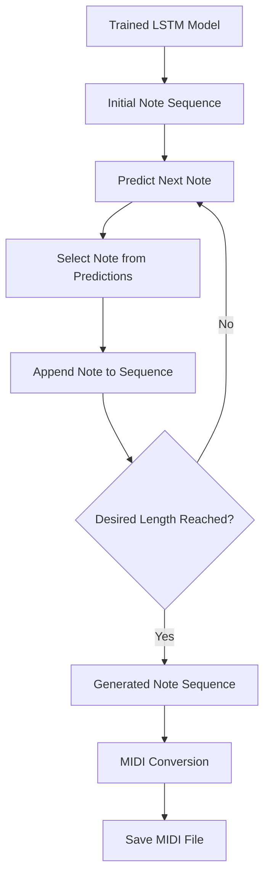

# 🎵 AI Music Generation Using Deep Learning

An AI-powered **Music Generation System** that learns musical patterns from MIDI datasets and generates new musical compositions using deep learning techniques.

The project explores the application of Recurrent Neural Networks (RNNs), particularly **Long Short-Term Memory (LSTM)** networks, to learn sequential patterns in music. Using MIDI preprocessing and sequence-based learning, the model captures relationships between musical notes and generates new sequences that can be converted into MIDI files.

The generated compositions can be saved, further processed, and played using compatible MIDI software.

---

## 📌 Project Overview

The AI Music Generation system aims to create original musical sequences by learning patterns from existing MIDI compositions.

The system uses a collection of MIDI files as training data. These files are processed into structured note sequences, which are then used to train a deep learning model.

After training, the model predicts subsequent musical notes based on previously learned patterns and generates new sequences that can be converted into playable MIDI files.

### 🎯 Objectives

- Collect MIDI music datasets from different musical genres.
- Preprocess MIDI files into structured note sequences.
- Extract musical information such as pitches, durations, and timing.
- Build a deep learning model using RNN or LSTM architecture.
- Train the model to recognize sequential musical patterns.
- Generate new musical note sequences.
- Convert generated sequences into MIDI files.
- Save and play the generated compositions.

---

## ✨ Key Features

| Feature | Description |
|---|---|
| 🎼 MIDI Dataset Processing | Load and process MIDI music files. |
| 🎹 Note Extraction | Extract musical notes and relevant information. |
| 🔄 Sequence Preparation | Convert notes into sequences suitable for model training. |
| 🧠 LSTM-Based Learning | Learn temporal patterns in musical compositions. |
| 📊 Model Training | Train a deep learning model using processed music data. |
| 🎵 Music Generation | Generate new musical note sequences. |
| 💾 MIDI Export | Convert generated sequences into MIDI files. |
| 🔊 Music Playback | Play generated compositions using compatible software (if implemented). |

---

## 🏗️ System Architecture

The project follows a deep learning pipeline that transforms raw MIDI files into generated musical compositions.



### Architecture Components

1. **MIDI Dataset:** Contains musical compositions used for training.
2. **MIDI Processing:** Loads MIDI files and extracts musical information.
3. **Feature Extraction:** Extracts notes, pitches, durations, and timing information.
4. **Sequence Preparation:** Converts musical information into sequences suitable for deep learning.
5. **LSTM Model:** Learns sequential relationships and musical patterns.
6. **Model Training:** Trains the network using prepared musical sequences.
7. **Music Generation:** Predicts new musical notes based on learned patterns.
8. **MIDI Conversion:** Converts generated notes into a MIDI composition.
9. **Playback and Export:** Saves the generated composition for playback.

---

## 🔄 Music Generation Workflow

The following sequence diagram illustrates the complete process from dataset loading to music generation.



---

## 🎼 MIDI Data Processing

MIDI (Musical Instrument Digital Interface) files contain structured information about musical events, including notes, pitches, timing, and instrument information.

The project uses MIDI preprocessing to transform musical compositions into a format that can be understood by a deep learning model.

### 1. Dataset Collection

Collect MIDI files from suitable public music datasets.

Possible dataset sources include:

- [MAESTRO Dataset](https://magenta.tensorflow.org/datasets/maestro)
- [Lakh MIDI Dataset](https://colinraffel.com/projects/lmd/)
- [Free MIDI Files](https://www.mididb.com/)

The dataset can contain classical, jazz, piano, or other musical compositions.

### 2. MIDI File Processing

MIDI files are loaded and analyzed to extract musical events.

The `music21` Python library can be used to:

- Load MIDI files.
- Extract musical notes.
- Identify pitch values.
- Extract note durations.
- Process musical sequences.
- Convert generated musical structures back into MIDI.

### 3. Note Sequence Extraction

The extracted musical notes are converted into numerical representations.

Example:

```text
Original Musical Notes:

C4 → E4 → G4 → A4 → G4 → E4

Numerical Representation:

60 → 64 → 67 → 69 → 67 → 64
```

Each numerical value represents a MIDI pitch number.

Note: Pitch-only representation is a simplified approach. Duration and timing information can also be included for richer musical generation.

### 4. Sequence Preparation

Musical notes are grouped into fixed-length sequences to create training samples.

For example:

```text
Input Sequence:
[60, 64, 67, 69]

Target Output:
67
```

The model learns to predict the next musical note based on previously observed notes.

---

## 🧠 Deep Learning Model – LSTM

The project uses a Long Short-Term Memory (LSTM) network, a specialized type of Recurrent Neural Network (RNN) designed to learn patterns in sequential data.

Unlike traditional feedforward neural networks, LSTMs maintain information from previous time steps, making them suitable for learning musical sequences.

### LSTM Architecture



### Model Components

| Component | Purpose |
|---|---|
| Input Layer | Receives encoded musical note sequences. |
| Embedding Layer | Learns dense representations of musical notes (if used). |
| LSTM Layers | Capture temporal relationships between notes. |
| Dropout Layer | Helps reduce overfitting during training. |
| Dense Layer | Maps learned representations to output predictions. |
| Softmax Layer | Produces probabilities for possible next notes. |

*The architecture can be adjusted depending on the model implementation. An embedding layer is optional.*

### How Music Generation Works

1. Provide an initial sequence of musical notes.
2. Pass the sequence through the trained LSTM model.
3. Predict the probability distribution of the next note.
4. Select the next note using a sampling strategy.
5. Append the predicted note to the existing sequence.
6. Repeat until the desired sequence length is reached.

---

## 🎵 Music Generation Process

After training, the model can generate new musical compositions using previously learned patterns.

### Generation Pipeline



### MIDI Export

The generated musical sequences are converted into MIDI format.

The `music21` library can be used to:

- Create musical note objects.
- Assign note durations.
- Organize notes into musical streams.
- Convert streams into MIDI files.
- Export the generated composition.

Example output:

```text
generated_music.mid
```

The generated MIDI file can be opened using compatible music software or MIDI players.

---

## 🛠️ Technology Stack

| Technology | Purpose |
|---|---|
| Python | Core programming language |
| TensorFlow / Keras or PyTorch | Deep learning model development |
| music21 | MIDI processing and music representation |
| NumPy | Numerical computations |
| Pandas | Dataset organization (if required) |
| Matplotlib | Training visualization and analysis |
| MIDI Files | Musical training data |

### Core Concepts

- Recurrent Neural Networks (RNNs)
- Long Short-Term Memory (LSTM)
- Sequential Data Processing
- MIDI Data Processing
- Feature Extraction
- Deep Learning Model Training
- Next-Note Prediction
- Generative Music Modeling

---

## 📂 Project Structure

```text
AI-Music-Generation/
│
├── dataset/
│   └── midi_files/          # Training MIDI files
│
├── preprocessing/
│   └── midi_processor.py    # MIDI loading and note extraction
│
├── models/
│   └── lstm_model.py        # LSTM architecture
│
├── training/
│   └── train.py             # Model training pipeline
│
├── generation/
│   └── generate_music.py    # Music generation logic
│
├── output/
│   └── generated_music.mid # Generated MIDI compositions
│
├── requirements.txt         # Project dependencies
├── main.py                  # Main application entry point
└── README.md                # Project documentation
```

*Adjust the folder structure according to your actual repository.*

---

## ⚙️ Installation & Setup

Follow these steps to run the project locally.

### 1. Clone the Repository

```bash
git clone https://github.com/Avinash-K18/AI-Music-Generation.git
```

### 2. Navigate to the Project Directory

```bash
cd AI-Music-Generation
```

### 3. Create a Virtual Environment

```bash
python -m venv venv
```

Activate the environment:

**Windows:**

```bash
venv\Scripts\activate
```

**Linux / macOS:**

```bash
source venv/bin/activate
```

### 4. Install Dependencies

```bash
pip install -r requirements.txt
```

### 5. Prepare the Dataset

Place the MIDI training files inside the dataset directory.

### 6. Train the Model

Run the training script:

```bash
python training/train.py
```

### 7. Generate Music

Run the generation script:

```bash
python generation/generate_music.py
```

The generated MIDI composition will be saved in the output directory.

*Use the actual script names and commands from your implementation.*

---

## 📊 Example Input and Output

### Input

A collection of MIDI files containing musical compositions.

```text
dataset/
├── composition_1.mid
├── composition_2.mid
├── composition_3.mid
└── composition_4.mid
```

### Model Processing

```text
MIDI Files
    ↓
Note Extraction
    ↓
Sequence Preparation
    ↓
LSTM Training
    ↓
Next Note Prediction
```

### Output

```text
output/
└── generated_music.mid
```

The generated MIDI file contains a newly predicted sequence of musical notes based on patterns learned during training.

---


### Audio Sample

If you export the generated MIDI into an audio format such as MP3 or WAV, you can link the sample here:

```markdown
[Listen to Generated Music](assets/generated-music.mp3)
```

---

## 🚀 Future Enhancements

Potential improvements for future versions include:

- Support for multiple musical genres.
- Incorporate note duration and velocity prediction.
- Generate complete musical compositions.
- Experiment with GAN-based music generation.
- Implement Transformer-based music generation.
- Add temperature-based sampling for controlling musical diversity.
- Build a web interface for music generation.
- Add real-time MIDI playback.
- Support multiple instruments and musical arrangements.
- Improve musical coherence through longer sequence modeling.

---

## 🎓 Learning Outcomes

Through this project, the following concepts can be explored:

- Deep Learning and Neural Networks.
- Recurrent Neural Networks (RNNs).
- Long Short-Term Memory (LSTM).
- Sequential Data Modeling.
- MIDI File Processing.
- Musical Feature Extraction.
- Next-Note Prediction.
- Model Training and Evaluation.
- Generative AI Applications.
- Converting model predictions into MIDI compositions.

---

## 👨‍💻 Author

**Avinash Kumar**

GitHub: [@Avinash-K18](https://github.com/Avinash-K18)

---

## ⭐ Support

If you find this project interesting, consider giving the repository a ⭐ on GitHub!

**Project:** AI Music Generation  
**Category:** Artificial Intelligence / Deep Learning / Generative AI  
**Task:** CodeAlpha Internship – Task 3
